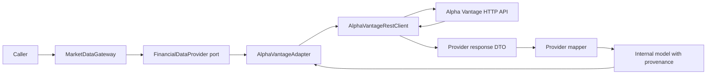

# Backend design: capability modules with ports and adapters

## Status and scope

Implemented structure for the US-002 backend refactor, based on the provider draft
at commit `341ae80`. Capability modules live inside one Spring application, with
application-owned ports and provider-specific adapters. Future inbound HTTP,
persistence, portfolio, and research packages remain proposals until needed.

Keep one backend build and deployment. Start with `marketdata`; add portfolio and
research modules when their behavior is implemented. A module here is a Kotlin
package with an owned interface and implementation, not a separate service or
Gradle subproject. One Spring application context wires them together.

## Ownership and dependencies

Organize by business capability first, then by architectural role:

```text
com.kenkwok.investmentos
├── InvestmentOsApplication
└── marketdata
    ├── domain
    │   ├── instrument and financial models
    │   └── value objects, provenance, and sourced results
    ├── application
    │   ├── MarketDataGateway
    │   ├── MarketDataException and MarketDataError
    │   └── port/out
    │       └── provider capability interfaces
    ├── adapter
    │   └── out/alphavantage
    │       ├── AlphaVantageAdapter
    │       ├── AlphaVantageRestClient
    │       ├── dto/request
    │       ├── dto/response
    │       └── mapper
    └── configuration
        └── Spring wiring and provider properties
```

Future inbound HTTP controllers belong in `marketdata.adapter.in.web`, with
their own request/response DTOs. Persistence adapters belong in
`marketdata.adapter.out.persistence` when persistence is introduced. Create these
packages only when used.

| Role | Owns | Allowed project dependencies |
| --- | --- | --- |
| Domain | Financial meaning, value validation, internal models, provenance | Domain only |
| Application | Input normalization, use cases, provider selection, outbound ports, typed operational errors | Domain and its own application contracts |
| Adapter | External protocols, DTOs, HTTP failure translation, provider mapping | Application ports/errors and domain |
| Configuration | Construction, configuration validation, resource lifecycle | All roles in its module |

Domain and application code do not import Spring, Jackson, JPA, HTTP client types,
or adapter classes. Configuration is the composition root: its references to
concrete adapters are intentional. Cross-module callers use the owning module's
documented application interface and returned domain models; they do not import
its adapters or provider DTOs. Avoid a shared dumping-ground package.

`MarketDataGateway` remains the inbound application interface as a concrete
class; a matching interface would add no useful variation today. Preserve the
capability ports (`InstrumentProvider`, `HistoricalPriceProvider`,
`FinancialStatementProvider`, and `MacroSeriesProvider`) and the existing
`FinancialDataProvider` composite for current provider registration. Revisit the
composite when a real second provider supports a different capability mix; do not
change provider routing or fallback semantics as part of package restructuring.

Kotlin `internal` applies to the Gradle module, not a package. Use it to narrow
exposure where possible, and use architecture tests to enforce package ownership.

## Domain validation and errors

`Symbol` and `DateRange` reject invalid values with the domain-owned
`InvalidMarketDataValue` exception, whose messages do not include raw inputs.
This keeps value validation independent of application error handling.
`MarketDataGateway` translates that exception into the existing `INVALID_INPUT`
application error. Mappers translate invalid values received from a provider into
`MALFORMED_RESPONSE`. Keep operational failures, such as rate limiting and disabled
configuration, outside the domain.

Preserve the gateway's public operations and `MarketDataError` codes. Package
imports will change, but caller-visible financial behavior should remain stable.

## Typed provider client and mapping

The external flow is:



`AlphaVantageRestClient` is a concrete, adapter-private client. It is not another
application port. Give it typed endpoint operations rather than exposing a
generic `Map<String, String> -> JsonNode` operation:

| Client operation | Request DTO | Response DTO |
| --- | --- | --- |
| `search` | `SymbolSearchRequest(keywords)` | `SymbolSearchResponse` with match DTOs |
| `overview` | `OverviewRequest(symbol)` | `OverviewResponse` |
| `dailyPrices` | `DailyPricesRequest(symbol, outputSize)` | `DailyPricesResponse` with metadata and date-keyed bar DTOs |
| `incomeStatement` | `StatementRequest(symbol)` | `IncomeStatementResponse` with annual/quarterly report DTOs |
| `balanceSheet` | `StatementRequest(symbol)` | `BalanceSheetResponse` with annual/quarterly report DTOs |
| `cashFlow` | `StatementRequest(symbol)` | `CashFlowResponse` with annual/quarterly report DTOs |
| `macroSeries` | `MacroSeriesRequest(function, interval, maturity)` | `MacroSeriesResponse` with observation DTOs |

Function, output size, interval, and maturity use adapter-owned constrained types
where applicable. The client owns endpoint/function names and encodes query
parameters. These are GET query DTOs, not JSON request bodies. API keys come from
private client configuration and never appear in request DTOs or generated
`toString` output. Response DTOs contain only fields the adapter consumes and
tolerate unrelated extra provider fields.

Use provider JSON property annotations on response DTOs, including numbered field
names. Keep numeric/date fields as raw strings until mapping. Configure strict
string deserialization for this client: Jackson must reject numeric/boolean JSON
tokens rather than coerce them into strings. A missing required field must not
become a valid result through defaults; preserve the difference between an absent
required collection and a present empty collection.

The client checks HTTP status, then successful-status error envelopes (`Note`,
`Information`, `Error Message`), before binding the success DTO. A bounded private
JSON-tree decoding step is acceptable for envelope detection and the empty
overview case; JSON trees do not cross the typed client interface. Preserve the
empty overview as an explicit not-found outcome so the adapter can perform the
existing exact-ETF search fallback.

Use explicit Kotlin mapping classes grouped by instruments, prices, statements,
and macro data. Do not add a mapping framework. Mappers are deterministic and do
not perform HTTP calls, select providers, read the clock, or retry requests. They:

- Parse decimals directly with `BigDecimal` and volumes with exact `Long`
  conversion; reject malformed values and invalid OHLC ranges.
- Preserve known missing-value markers as null for optional fields. Require
  report currency and other mandatory fields.
- Verify returned symbols, retain units/timezones, sort dates, reject duplicate
  report/observation dates, and retain the available price-history window before
  filtering to the requested range.
- Keep raw prices explicitly raw and publication time unknown where absent.

The adapter selects the client operation, invokes the mapper, and attaches
provenance using an injected `Clock` and the actual endpoint dataset. It preserves
the documented US coverage, compact history, and ETF fallback. A fallback result
keeps search provenance rather than claiming it came from company overview.

## RestClient configuration and failure handling

Use Spring's imperative `RestClient`, built from an injected Boot-managed builder.
Verify/add `spring-boot-starter-restclient` for the configured Boot version; do not
assume the MVC starter supplies client auto-configuration. Explicitly select the
request factory so adding an unrelated library cannot change HTTP behavior.
Keep provider-specific Jackson settings local to this client.

The HTTP implementation must preserve the existing transport guarantees:

- Bounded connection time, bounded response reads, and a deadline covering the
  complete response body, including a server that sends headers and then stalls
  or trickles bytes. A socket read timeout alone does not establish that deadline.
- An enforced streaming byte limit, including chunked responses without a
  `Content-Length`; checking size after buffering is insufficient.
- Redirects disabled and cancellation/resource cleanup when a deadline or limit
  is exceeded. The Spring configuration owns client shutdown.
- HTTP 401/403, 404, 429, other failures, and HTTP-200 error envelopes mapped to
  the existing safe application error categories; retain valid `Retry-After`
  durations for rate limiting.
- Credentials and raw provider payloads excluded from error messages, causes,
  HTTP logs, and observation tags. Audit Boot/client instrumentation because the
  credential is carried in a query parameter.

`BoundedJdkRequestFactory` adapts the existing JDK asynchronous body subscriber to
Spring's request-factory interface. It buffers at most 8 MiB and waits for the
whole response within the configured deadline, cancelling the future on timeout.
The injected JDK client supplies the connect timeout and disables redirects.
`RestClient` handles requests and response exchange; private Jackson decoding
checks envelopes before binding endpoint DTOs. No extra worker executor is needed.

The factory adds the API key immediately before the JDK send. RestClient
interceptors and observations therefore see a URI without the credential. Keep
JDK wire/request debug logging disabled because the actual wire URI must contain
the key. Local-server tests exercise these behaviors, including chunked bodies,
trickled responses, client reuse after timeout, and observation/interceptor URIs.

Keep automatic retries and cross-provider fallback disabled. A later application
workflow can decide whether and when to retry based on quota and error codes.
Make remote calls outside database transactions; future persistence should save
validated results in a short application transaction after retrieval.

## Architect Framework decision

Do not add Architect Framework for current read-only provider requests. Inspection
of its `ReliableExternalOperationAdapter` shows a durable state-changing operation
contract (`invoke`, `lookup`, compensation, stable idempotency key), rather than a
typed HTTP client. The starter exposes Kafka, Avro, and JPA dependencies and has
signing/data-protection configuration requirements. Its core is smaller, but its
external-operation contract still does not model market-data retrieval well.

Reassess it when a concrete workflow needs durable intents, recovery after a
crash, events, or sagas. A read request consuming quota is not sufficient reason
to introduce those mechanisms. Future adoption should use a versioned dependency
with compatibility tests, not an absolute sibling-checkout build dependency.

## Refactor sequence and ongoing verification

1. Move models, gateway, ports, errors, and wiring into the target packages.
   Resolve domain validation dependencies and update existing tests/callers.
   Preserve operations, configuration defaults, and provider selection behavior.
2. Introduce typed request/response DTOs and pure mappers behind the existing
   provider port. Exercise endpoint fixtures, strict token handling, precision,
   missing fields, provenance, symbol mismatches, and ETF fallback through the
   adapter. Use focused mapper tests for meaningful conversion edge cases.
3. Replace the HTTP client with `RestClient`. Run local-server tests for query
   encoding, error envelopes, status mapping, redirects, oversize/chunked bodies,
   stalled/trickled bodies, cancellation, and credential-safe failures. Mocks alone
   do not establish transport behavior.
4. Add test-scoped ArchUnit checks over compiled classes for the dependency table,
   including forbidden Spring/Jackson/JPA/HTTP dependencies in domain/application
   and forbidden application-to-adapter dependencies. Keep configuration as the
   explicit composition-root exception. Check cross-module adapter access as
   additional capability modules appear.
5. Update the backend README and provider guide to describe the implemented flow,
   then run `./gradlew build ktlintCheck` because dependencies change. Ordinary
   tests remain offline; keep the live provider task separate and opt-in.

Completion means all current provider capabilities still work through the
application interface, typed DTOs stay inside the adapter, dependency checks pass,
and financial/transport regression tests pass. This design adds no endpoint,
database migration, ingestion pipeline, automatic retry, or trading behavior.

The `.gitignore` exception for `backend/src/**/out/` is intentional: outbound port
and adapter source packages must be tracked even though generated output
directories elsewhere are ignored.

## References

- [Project context](PROJECT_CONTEXT.md)
- [Provider behavior and configuration](US-002_DATA_PROVIDERS.md)
- [Spring Boot REST client configuration](https://docs.spring.io/spring-boot/reference/io/rest-client.html)
- [Spring Framework REST clients](https://docs.spring.io/spring-framework/reference/integration/rest-clients.html)
- Architect Framework source at `~/IdeaProjects/architect-framework`, inspected
  as a local sibling checkout; it is not an application dependency.
